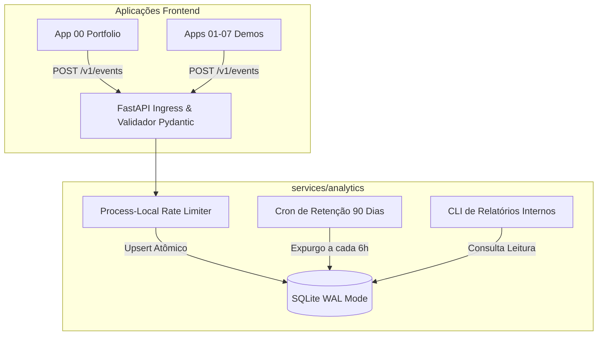

# Plano de Implementação: Minimal Self-Hosted Analytics Service

**Data:** 26/09/2026  
**Status:** Proposta de Arquitetura & Implementação por Etapas  
**Documento de Origem:** [minimal-analytics-implementation-plan.md](file:///c:/Users/rnorm/Documents/Projetos/ai-engineer-roadmap/docs/analytics/minimal-analytics-implementation-plan.md)  
**Escopo:** Apps 00 a 07 do `ai-engineer-roadmap`  
**Alvo de Deploy:** Coolify (VPS) com SQLite Persistente  

---

## 1. O Dilema: Monorepo vs Repositório Separado

A pergunta natural ao avaliar este projeto é:
> *"Esse serviço deve ficar dentro do monorepo ou parece 'sacanagem' misturar um analytics tradicional com um roadmap de IA?"*

### Análise Comparativa

| Dimensão | Opção A: `services/analytics/` (No Monorepo) | Opção B: Repositório Dedicado (`privacy-analytics`) |
| :--- | :--- | :--- |
| **Coerência Temática** | Mistura serviço operacional com aplicações demonstrativas de IA. | Mantém o monorepo 100% focado em casos de uso de IA aplicada. |
| **Operação no Coolify** | **Zero esforço:** Coolify já está conectado ao repo; basta criar uma aplicação apontando para `/services/analytics`. | Requer conectar outro repositório GitHub, chaves de deploy e gestão de 2 repositórios. |
| **Sincronia de Contratos** | **Perfeita:** Alterações de rotas nos frontends e regras de eventos são commitadas no mesmo PR. | Requer versionamento manual de contratos de API entre dois repositórios. |
| **Reaproveitamento** | Restrito ao ecossistema do roadmap. | Permite usar o mesmo analytics leve em outros sites pessoais / projetos. |
| **Isolamento de CI/CD** | Isolado facilmente via path-filters no GitHub Actions (`services/analytics/**`). | Isolado por definição. |

### Decisão Recomendada

**Adotar a Opção A (`services/analytics/` no monorepo):**
1. O repositório já possui a pasta [apps/](file:///c:/Users/rnorm/Documents/Projetos/ai-engineer-roadmap/apps) para as aplicações de portfólio. Criar [services/](file:///c:/Users/rnorm/Documents/Projetos/ai-engineer-roadmap/services) cria uma separação explícita entre *Aplicações de IA do Roadmap* e *Serviços de Suporte de Infraestrutura*.
2. Evita overhead de gerenciar múltiplos repositórios e branches separadas no Coolify.
3. Se no futuro fizer sentido torná-lo um projeto open source independente, a pasta `services/analytics/` já nasce completamente autocontida (com seu próprio `Dockerfile`, `requirements.txt` e testes) e pode ser extraída via `git subtree` em 2 minutos.

---

## 2. Visão Geral da Arquitetura

O sistema é um coletor de telemetria agregada que **mede atividade técnica sem coletar nenhuma identidade**:



### Princípios Invioláveis de Privacidade
1. **Sem Armazenamento de Eventos Brutos:** O banco **nunca grava um log individual**. Toda requisição aceita vira um incremento (`+1`) num contador agregado por hora.
2. **Zero PII:** Não grava IP, hash de IP, user-agent completo, cookies nem IDs de sessão.
3. **Sem Rastreamento de IA:** Não transmite prompts, arquivos, mensagens de chat ou saídas de modelo.
4. **Respeito a GPC/DNT:** Se o navegador indicar `Global Privacy Control` ou `Do Not Track`, o cliente não envia nenhum evento.
5. **Sem Banner de Cookies:** Como não usa cookies nem dados locais persistentes de rastreamento, não requer banner GDPR/LGPD.

---

## 3. Plano de Implementação por Etapas

### Etapa 1: Estrutura Base do Serviço (`services/analytics`)

- [ ] **1.1.** Criar a árvore de diretórios do serviço:
  ```text
  services/analytics/
  ├── app/
  │   ├── __init__.py
  │   ├── config.py
  │   ├── database.py
  │   ├── main.py
  │   ├── models.py
  │   ├── report.py
  │   └── retention.py
  ├── tests/
  │   ├── test_api.py
  │   └── test_aggregation.py
  ├── .env.example
  ├── Dockerfile
  ├── requirements.txt
  └── README.md
  ```
- [ ] **1.2.** Criar `requirements.txt` com dependências estritamente pinadas:
  ```text
  fastapi==0.115.8
  uvicorn[standard]==0.34.0
  pydantic==2.10.6
  pydantic-settings==2.8.0
  pytest==8.3.4
  httpx==0.28.1
  ```
- [ ] **1.3.** Criar `Dockerfile` multi-stage com imagem base imutável `python:3.12-slim@sha256:...`, usuário não-root (`UID 10001`) e healthcheck em `/health`.
- [ ] **1.4.** Criar `.env.example` com placeholders seguros (`ANALYTICS_DB_PATH=/data/analytics.sqlite3`, `ANALYTICS_RETENTION_DAYS=90`, `ANALYTICS_ALLOWED_ORIGINS=...`).

---

### Etapa 2: Banco de Dados e Agregação Atômica (`database.py` e `retention.py`)

- [ ] **2.1.** Implementar inicialização do SQLite em `database.py`:
  - Ativar modo WAL (`PRAGMA journal_mode=WAL`).
  - Configurar timeout de bloqueio (`PRAGMA busy_timeout=5000`).
  - Ativar modo de sincronização normal (`PRAGMA synchronous=NORMAL`).
- [ ] **2.2.** Criar a tabela `analytics_hourly`:
  ```sql
  CREATE TABLE IF NOT EXISTS analytics_hourly (
      bucket_start TEXT NOT NULL,
      schema_version INTEGER NOT NULL,
      event_name TEXT NOT NULL,
      app_id TEXT NOT NULL,
      route_key TEXT NOT NULL,
      locale TEXT NOT NULL,
      viewport TEXT NOT NULL,
      duration_bucket TEXT NOT NULL,
      event_count INTEGER NOT NULL CHECK (event_count > 0),
      PRIMARY KEY (
          bucket_start,
          schema_version,
          event_name,
          app_id,
          route_key,
          locale,
          viewport,
          duration_bucket
      )
  );
  ```
- [ ] **2.3.** Implementar método de incremento atômico via `INSERT ... ON CONFLICT DO UPDATE SET event_count = event_count + 1`.
- [ ] **2.4.** Implementar rotina de expurgo em `retention.py`:
  - Deleta buckets onde `bucket_start < datetime.now() - timedelta(days=90)`.
  - Executa `PRAGMA optimize` após limpeza.
  - Agenda execução na inicialização do serviço e a cada 6 horas em background.

---

### Etapa 3: API FastAPI e Endpoints Seguros (`main.py` e `models.py`)

- [ ] **3.1.** Definir o contrato Zod/Pydantic em `models.py`:
  - `schema_version`: Literal `1`.
  - `event_name`: Enum (`page_view`, `project_open`, `demo_started`, `demo_completed`, `demo_failed`).
  - `app_id`: Enum (`00`, `01`, `02`, `03`, `04`, `05`, `06`, `07`).
  - `route_key`: String validada por allowlist (ex: `home`, `project_detail`, `workspace`, `about`, `other`).
  - `locale`: Enum (`de`, `en`, `pt`, `other`).
  - `viewport`: Enum (`mobile`, `tablet`, `desktop`).
  - `duration_bucket`: Enum (`none`, `under_1s`, `1s_to_3s`, `3s_to_10s`, `over_10s`).
  - Configurar `model_config = ConfigDict(extra="forbid")` para rejeitar qualquer campo arbitrário.
- [ ] **3.2.** Implementar endpoint `POST /v1/events`:
  - Valida tamanho do payload (máx 2 KB).
  - Trunca timestamp do servidor para o início da hora UTC (`YYYY-MM-DDTHH:00:00Z`).
  - Realiza o upsert atômico no SQLite.
  - Retorna HTTP `204 No Content` com corpo vazio.
- [ ] **3.3.** Implementar endpoint `GET /health`:
  - Retorna `{"status": "ok"}` sem expor dados do banco ou configurações de ambiente.
- [ ] **3.4.** Configurar middlewares de segurança:
  - CORS restritivo com lista explícita de origens permitidas (sem wildcard `*`, sem credenciais).
  - Rate limiter em memória por processo (ex: token bucket de 50 req/s com burst de 100) sem rastrear IP.
  - Desativar access logs do Uvicorn em produção para garantir que nenhum IP de origem seja gravado em disco.

---

### Etapa 4: CLI de Relatórios Internos (`report.py`)

- [ ] **4.1.** Implementar script executável dentro do container:
  ```bash
  python -m app.report --days 7 --format table
  python -m app.report --days 30 --format json
  ```
- [ ] **4.2.** Formatar as 9 visões analíticas essenciais:
  1. Páginas vistas por dia e aplicação.
  2. Rotas mais acessadas.
  3. Taxa de cliques do App 00 para os demais apps.
  4. Inícios, conclusões e falhas por app.
  5. Taxa de sucesso/conclusão de cada demo (`demo_completed / demo_started`).
  6. Taxa de falha de cada demo (`demo_failed / demo_started`).
  7. Distribuição de tempo de resposta (`duration_bucket`).
  8. Distribuição de idiomas (`locale`).
  9. Distribuição de tamanhos de tela (`viewport`).
- [ ] **4.3.** Imprimir aviso legal no cabeçalho: "Os contadores representam eventos agregados, não pessoas únicas. Tráfego público pode incluir bots."

---

### Etapa 5: Cliente Frontend Leve nos Apps (`lib/analytics.ts`)

- [ ] **5.1.** Criar o módulo `lib/analytics.ts` nos frontends:
  - Verificar flag `NEXT_PUBLIC_ANALYTICS_ENABLED === 'true'`.
  - Checar `navigator.globalPrivacyControl` e `navigator.doNotTrack`. Se ativo, abortar silenciosamente.
  - Mapear rotas conhecidas; transformar parâmetros dinâmicos em `'other'`.
  - Disparar `fetch(ANALYTICS_URL + '/v1/events', { method: 'POST', keepalive: true, credentials: 'omit', cache: 'no-store' })`.
  - Capturar erros com `.catch(() => {})` para garantir que o analytics nunca afete a navegação ou o uso da aplicação.
- [ ] **5.2.** Criar componente `<AnalyticsPageView />` com deduplicação em memória para React Strict Mode.
- [ ] **5.3.** Instrumentar os eventos de ciclo de vida das demos nos Apps 01 a 07:
  - Submissão de input ➔ `demo_started`.
  - Resposta completa renderizada ➔ `demo_completed`.
  - Erro capturado de API ➔ `demo_failed`.

---

### Etapa 6: Testes Automatizados e Garantias de Privacidade

- [ ] **6.1.** Suíte de testes no backend (`services/analytics/tests/`):
  - Validação de aceitação de eventos permitidos.
  - Validação de rejeição (`422`) para campos extras ou valores não permitidos.
  - Teste de idempotência e incremento atômico (2 eventos iguais = `event_count == 2`).
  - Teste de exclusão de retenção (> 90 dias).
  - Teste de sanitização: enviar payload com IP simulado e prompt falso; assertar que nenhuma dessas strings existe no SQLite nem nos logs.
- [ ] **6.2.** Suíte de testes no frontend:
  - Assertar que o cliente não dispara nada se GPC/DNT estiver ativado.
  - Assertar que nenhuma informação é escrita no `localStorage`, `sessionStorage` ou `cookies`.

---

### Etapa 7: Documentação, Termos de Privacidade e Deploy no Coolify

- [ ] **7.1.** Atualizar os termos de privacidade no App 00 ([apps/00-portfolio/frontend/lib/i18n/dictionaries/](file:///c:/Users/rnorm/Documents/Projetos/ai-engineer-roadmap/apps/00-portfolio/frontend/lib/i18n/dictionaries/)):
  - Divulgar que o site coleta telemetria agregada e auto-hospedada.
  - Listar as dimensões coletadas e o prazo de expurgo de 90 dias.
  - Explicar que Do Not Track e Global Privacy Control desativam a coleta.
- [ ] **7.2.** Provisionar o serviço no Coolify:
  - Base Directory: `/services/analytics`.
  - Build pack: `Dockerfile`.
  - Volume persistente montado em `/data`.
  - Domínio com HTTPS (ex: `https://analytics.normando.dev`).
- [ ] **7.3.** Rollout faseado:
  - Subir o serviço com `NEXT_PUBLIC_ANALYTICS_ENABLED=false`.
  - Validar `/health`.
  - Ativar primeiro apenas no App 00 e acompanhar por 24 horas.
  - Ativar gradualmente nos Apps 01 ao 07.

---

## 4. Critérios de Sucesso (Definition of Done)

- [ ] O serviço roda de forma 100% autônoma no Coolify consumindo menos de 50MB de RAM.
- [ ] Nenhuma informação pessoal ou conteúdo de IA é trafegado ou gravado.
- [ ] O banco SQLite nunca retém linhas de eventos brutos, apenas agregados horários.
- [ ] A retenção de 90 dias limpa dados automaticamente.
- [ ] O cliente frontend não bloqueia o usuário caso o servidor de analytics caia.
- [ ] O mantenedor consegue extrair relatórios via comando CLI no container.
