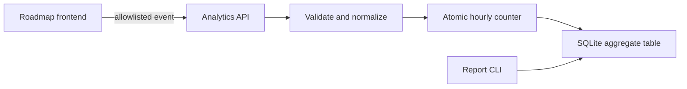

# Minimal self-hosted analytics implementation plan

Status: proposed  
Scope: Apps 00 through 06  
Owner: repository maintainer  
Implementation target: Codex  
Analytics provider: none; self-hosted only

## 1. Objective

Build a small analytics system that answers useful engineering questions without identifying visitors.

The system should measure activity, not people. It must help answer:

- Which portfolio pages and roadmap applications are actually opened?
- Which applications receive the most interaction?
- How often does a demo start, complete, or fail?
- Are failures concentrated in one application, viewport class, or locale?
- Are recent deployments improving or degrading completion rates?
- At which hours or days is the portfolio used?

The first version must not attempt to answer:

- Who visited?
- How many unique people visited?
- Whether the same person returned later.
- A visitor's location, company, browser fingerprint, or browsing history.
- What a visitor typed, uploaded, generated, or asked an AI service.

This distinction is intentional. Counting unique visitors requires a durable or probabilistic identifier and is outside the minimum-data design.

## 2. Privacy and engineering constraints

The implementation must preserve the repository's existing data-minimisation decisions.

### Must not collect or store

- IP addresses.
- HMACs, hashes, or other pseudonyms derived from IP addresses.
- Cookies or analytics identifiers.
- Values in localStorage or sessionStorage for analytics.
- Device fingerprints.
- Complete user-agent strings.
- Complete referrer URLs or referring domains.
- Full URLs, query strings, URL fragments, or dynamic route parameters.
- Names, email addresses, account identifiers, or authentication data.
- Prompts, messages, generated content, document names, document contents, or images.
- Azure request/response payloads.
- Precise client timestamps.
- Free-form event properties.
- Cross-application or cross-device identifiers.

### Required behaviour

- All persisted rows are aggregate counters, never raw events.
- The server generates the time bucket; client timestamps are ignored.
- Input fields use small server-side allowlists.
- Analytics failures never block navigation or application features.
- The client sends requests without credentials.
- Global Privacy Control and Do Not Track are honored.
- Analytics can be disabled globally and per frontend through environment variables.
- Production dependencies and container images use exact versions, never caret or open-ended ranges.
- No third-party analytics, telemetry SDK, CDN script, or log drain is introduced.
- The analytics database is disposable and must not be included in long-lived backups.

## 3. Recommended architecture

Create a dedicated service:

```text
services/analytics/
├── app/
│   ├── __init__.py
│   ├── config.py
│   ├── database.py
│   ├── main.py
│   ├── models.py
│   ├── report.py
│   └── retention.py
├── tests/
├── .env.example
├── Dockerfile
├── requirements.txt
└── README.md
```

Use Python, FastAPI, and SQLite because:

- Apps 01 through 05 already use FastAPI conventions.
- SQLite is sufficient for the expected portfolio traffic.
- SQL aggregation and retention are simple to inspect.
- The service requires no external account or additional processor.
- It can be deployed as one independent Coolify resource.

Do not place this service inside an existing application backend. A separate service avoids coupling portfolio metrics to an AI demo and allows analytics to fail or be disabled independently.

### Request flow



The API must aggregate an accepted event immediately with an atomic SQLite upsert. It must never insert a raw-event row.

## 4. Events and their purpose

Only the following event names are allowed in version 1.

| Event | When it is emitted | Engineering purpose |
| --- | --- | --- |
| `page_view` | A known static route becomes visible | Measure interest by application and route |
| `project_open` | A visitor opens an app from the portfolio | Measure portfolio-to-demo navigation |
| `demo_started` | A visitor explicitly starts a core demo action | Measure genuine feature usage |
| `demo_completed` | The core action finishes successfully | Calculate completion rate |
| `demo_failed` | The core action ends with a handled failure | Detect reliability regressions |

Do not add events for clicks that do not answer an engineering question.

### Core demo action by application

| App | Start | Complete | Fail |
| --- | --- | --- | --- |
| 00 Portfolio | Not applicable | Not applicable | Not applicable |
| 01 Smart Inspector | Image analysis submitted | Analysis rendered | Analysis request failed |
| 02 Support Bot | Message submitted | Assistant response rendered | Message request failed |
| 03 Prompt Forge | Generation submitted | Stream completed | Generation failed |
| 04 Pocket RAG | Document query submitted | Grounded answer rendered | Query failed |
| 05 Agentic Workflow | Workflow started | Workflow reached completed state | Workflow failed |
| 06 Agent Workspace | Message submitted | Agent response completed | Agent request failed |

Uploading a document is not an analytics event. The analytics service must not receive filenames, MIME types, prompt length, document size, or content-derived properties.

## 5. Event contract

### Endpoint

```http
POST /v1/events
Content-Type: application/json
```

A successful request returns `204 No Content`.

### Payload

```json
{
  "schema_version": 1,
  "event_name": "demo_completed",
  "app_id": "03",
  "route_key": "workspace",
  "locale": "en",
  "viewport": "desktop",
  "duration_bucket": "3s_to_10s"
}
```

### Allowed values

- `schema_version`: exactly `1`.
- `event_name`: one of the five defined events.
- `app_id`: `00` through `06`.
- `route_key`: a fixed value registered for that application.
- `locale`: `de`, `en`, `pt`, or `other`.
- `viewport`: `mobile`, `tablet`, or `desktop`.
- `duration_bucket`: `none`, `under_1s`, `1s_to_3s`, `3s_to_10s`, or `over_10s`.

All fields are required. Use the explicit value `none` instead of nullable dimensions so composite keys remain deterministic in SQLite.

### Route rules

Each frontend owns a fixed route-to-key map. Examples:

| Application | Browser route | Stored key |
| --- | --- | --- |
| 00 | `/` | `home` |
| 00 | `/projects/[slug]` | `project_detail` |
| 00 | `/about` | `about` |
| 00 | `/datenschutz` | `privacy` |
| 00 | `/impressum` | `legal_notice` |
| 01–06 | Main application route | `workspace` |
| Any | Unknown or dynamic route | `other` |

Locale prefixes must be removed before mapping. Query strings, hashes, slugs, document IDs, conversation IDs, and other dynamic values must never be transmitted.

### Request rejection

Return `422` for unknown fields or values. Pydantic models must forbid extra fields. Limit request bodies to 2 KB. Do not echo invalid payloads in responses or logs.

## 6. Database design

Use one aggregate table and one migration table.

```sql
CREATE TABLE analytics_hourly (
    bucket_start TEXT NOT NULL,
    schema_version INTEGER NOT NULL,
    event_name TEXT NOT NULL,
    app_id TEXT NOT NULL,
    route_key TEXT NOT NULL,
    locale TEXT NOT NULL,
    viewport TEXT NOT NULL,
    duration_bucket TEXT NOT NULL,
    event_count INTEGER NOT NULL CHECK (event_count > 0),
    PRIMARY KEY (
        bucket_start,
        schema_version,
        event_name,
        app_id,
        route_key,
        locale,
        viewport,
        duration_bucket
    )
);
```

Requirements:

- `bucket_start` is generated by the server in UTC and rounded down to the hour.
- Increment counters with `INSERT ... ON CONFLICT DO UPDATE`.
- Enable WAL mode.
- Configure a SQLite busy timeout.
- Use parameterized SQL only.
- Never create a raw-events table.
- Never add columns for IP, user agent, referrer, visitor ID, session ID, or request ID.
- Add an index only if a measured report query requires it.

## 7. Retention

Set aggregate retention to 90 days.

```dotenv
ANALYTICS_RETENTION_DAYS=90
```

Retention must run:

- at service startup;
- every six hours while the service is running;
- before a report is generated.

Delete buckets where `bucket_start` is older than the configured retention window. Run `PRAGMA optimize` after cleanup. Do not run `VACUUM` on every cleanup; document a manual maintenance command if it becomes necessary.

The SQLite volume should not be copied into long-lived backups. If Coolify or host-level backups include the volume, their retention must not exceed the analytics retention period.

## 8. API and process behaviour

Implement only:

| Method | Route | Purpose |
| --- | --- | --- |
| `GET` | `/health` | Liveness/readiness without database contents |
| `POST` | `/v1/events` | Validate and aggregate one event |

Do not expose a public reporting or dashboard endpoint in version 1.

### CORS

- Maintain an exact production-origin allowlist.
- Do not use `*`.
- Do not allow credentials.
- Allow only `POST`, `OPTIONS`, and the required headers.
- Development origins must be explicit and enabled only outside production.

CORS is not an authentication control. The reports must state that public counters can be affected by automated traffic.

### Abuse protection

Use a bounded, process-local global limiter rather than an identity-based limiter:

- maximum accepted requests per second;
- maximum burst size;
- no per-IP key;
- no persistent rate-limit database;
- reject excess events with `429`;
- do not log the request body or remote address.

This protects basic service capacity without creating visitor identifiers. Metrics are directional product signals, not billing or security evidence.

### Logging

- Disable Uvicorn access logs for this service in production.
- Log only startup, migration, cleanup, database availability, and aggregate internal errors.
- Never log request headers, remote addresses, event payloads, or validation bodies.
- Use the existing Docker rotation policy: `json-file`, `max-size=10m`, `max-file=3`.
- Ensure health checks do not produce application logs.

## 9. Reporting

Provide a local command executed inside the analytics container:

```bash
python -m app.report --days 7 --format table
python -m app.report --days 30 --format json
```

Reports may contain only aggregates.

Required report sections:

1. Page views by day and app.
2. Page views by route.
3. Project opens from App 00.
4. Demo starts, completions, and failures by app.
5. Completion rate by app.
6. Failure rate by app.
7. Duration-bucket distribution by app.
8. Locale distribution.
9. Viewport-class distribution.

Rules:

- Enforce a maximum report window of 90 days.
- Print a warning that counts represent events, not unique people.
- Print a warning that public events may include bots.
- Do not add CSV export in version 1 unless a real need appears.
- Do not expose the SQLite database through the frontend.

## 10. Frontend client

Add a small local analytics module to each frontend rather than a shared workspace dependency. The current applications deploy from separate Coolify base directories, so a cross-workspace runtime dependency could break isolated Docker build contexts.

Suggested files:

```text
apps/<app>/frontend/lib/analytics.ts
apps/<app>/frontend/components/AnalyticsPageView.tsx
apps/<app>/frontend/lib/analytics.test.ts
```

### Client requirements

- Use a typed event union.
- Contain a fixed `APP_ID`.
- Normalize routes locally using a fixed map.
- Calculate only coarse viewport and duration buckets.
- Send with `fetch`, `keepalive: true`, `credentials: "omit"`, and `cache: "no-store"`.
- Swallow network errors silently.
- Do not retry.
- Do not queue events offline.
- Do not write analytics data to browser storage.
- Do not inspect or transmit user input.
- Do not read cookies.
- Do not add analytics parameters to links.
- Do not send when the page is not visible.
- Deduplicate React development/Strict Mode double execution in memory only.
- Stop immediately when analytics is disabled, GPC is enabled, or DNT equals `1`.

### Environment variables

Every frontend:

```dotenv
NEXT_PUBLIC_ANALYTICS_ENABLED=false
NEXT_PUBLIC_ANALYTICS_URL=https://analytics.normando.dev
```

Analytics service:

```dotenv
APP_ENV=production
ANALYTICS_DB_PATH=/data/analytics.sqlite3
ANALYTICS_RETENTION_DAYS=90
ANALYTICS_ALLOWED_ORIGINS=https://normando.dev,<exact-app-origins>
ANALYTICS_MAX_REQUESTS_PER_SECOND=<bounded-integer>
ANALYTICS_BURST_SIZE=<bounded-integer>
```

Do not put a secret in a `NEXT_PUBLIC_*` variable. The ingestion endpoint is intentionally public and restricted by schema, CORS, payload size, and capacity limits.

## 11. Configuration and version policy

Implementation must follow these rules:

- Pin Python packages to exact versions in `requirements.txt`.
- Pin the Docker base image to an exact patch version; use a digest when practical.
- Do not introduce `>=`, `~=`, `^`, `latest`, or unbounded image tags.
- Do not change unrelated application versions.
- Keep `ANALYTICS_RETENTION_DAYS` and rate settings explicit in Coolify.
- Production must fail startup for missing or invalid required configuration.
- Development may use safe local defaults, but they must be documented.

## 12. Tests

### Backend unit and integration tests

- Accept every valid event combination required by the UI.
- Reject unknown event names, apps, routes, locales, viewport values, and duration buckets.
- Reject extra properties.
- Reject request bodies above 2 KB.
- Confirm that two identical events increment one aggregate row.
- Confirm that different dimensions create different aggregate rows.
- Confirm that timestamps are server-generated and rounded to UTC hours.
- Confirm concurrent writes do not lose increments.
- Confirm retention deletes expired buckets and preserves recent buckets.
- Confirm the limiter is bounded and creates no client identifier.
- Confirm `/health` returns no configuration or database details.
- Confirm CORS accepts production origins and rejects unknown origins.
- Confirm the database schema contains no disallowed columns.
- Use a known test IP, prompt, filename, and user-agent and verify none appears in SQLite or captured application logs.

### Frontend tests

- Disabled analytics sends nothing.
- DNT and GPC send nothing.
- Known routes map to fixed route keys.
- Unknown and dynamic routes become `other`.
- Locale prefixes are removed before route mapping.
- Query strings and fragments never enter the payload.
- Strict Mode duplicate page-view effects produce one immediate event.
- Network failures do not affect the user action.
- Demo lifecycle instrumentation emits the correct event sequence.
- Payloads contain no arbitrary properties.
- The client never reads or writes cookies, localStorage, or sessionStorage.

### End-to-end verification

- Deploy the service with all frontends disabled.
- Verify `/health`.
- Enable App 00 only.
- Generate known page views and project opens.
- Run the report command and compare exact counts.
- Inspect SQLite directly and verify only aggregate rows exist.
- Inspect Docker logs and verify no IPs or payloads appear.
- Enable one demo app and verify start/complete/fail events.
- Enable remaining apps gradually.

## 13. Documentation and disclosure updates

Before production enablement:

1. Update `docs/privacy/data-flow-audit.md`:
   - replace the statement that analytics is out of scope;
   - document aggregate self-hosted analytics;
   - record the exact fields and 90-day retention;
   - remove the stale deployment-blocker text about legal-page placeholders.
2. Update `docs/privacy/production-retention.md` with the analytics volume and retention verification.
3. Update the localized Datenschutz/Privacy Policy text in App 00:
   - state that self-hosted aggregate usage counters are collected;
   - list the exact coarse dimensions;
   - state that no cookies, persistent IDs, IP storage, fingerprinting, or third-party analytics are used;
   - state the 90-day retention;
   - explain that GPC and DNT disable collection.
4. Do not add a cookie banner because this implementation adds no analytics cookie or browser identifier. This is a technical design decision, not a substitute for legal review.
5. Update the service README with deployment, reporting, retention, and deletion commands.

The analytics feature must remain disabled until the published privacy text matches the deployed behaviour.

## 14. Coolify deployment

Create one new Coolify resource from:

```text
/services/analytics
```

Configuration:

- Build from the service Dockerfile.
- Attach a persistent volume at `/data`.
- Configure `analytics.normando.dev` with HTTPS.
- Set the exact origin allowlist.
- Set the retention and global rate limits.
- Disable public directory browsing.
- Use the existing Docker log rotation.
- Configure a health check against `/health`.
- Do not configure external log shipping.
- Do not include the analytics volume in indefinite backups.

After the service is healthy, configure the public URL in each frontend but leave `NEXT_PUBLIC_ANALYTICS_ENABLED=false` until its instrumentation and disclosure are deployed.

## 15. Rollout and rollback

### Rollout

1. Deploy the service with no enabled frontend.
2. Verify configuration, CORS, logs, SQLite schema, and retention.
3. Publish the updated privacy documentation.
4. Enable App 00.
5. Observe counts and resource usage for at least one day.
6. Enable Apps 01 through 06 one at a time.
7. Validate the report after every enablement.

### Rollback

1. Set `NEXT_PUBLIC_ANALYTICS_ENABLED=false` on all frontends and redeploy them.
2. Confirm no new counters arrive.
3. Stop the analytics resource.
4. If analytics is abandoned, remove the Coolify volume.
5. Revert disclosure text only after collection has stopped and retained data has been deleted.

Analytics must be non-critical: stopping or deleting the service must not affect any roadmap application.

## 16. Suggested implementation sequence

Use a new branch from the latest `main`. Keep commits small and independently reviewable.

1. `docs: define minimal analytics contracts`
2. `feat(analytics): scaffold FastAPI service`
3. `feat(analytics): aggregate events in SQLite`
4. `feat(analytics): enforce retention and bounded ingestion`
5. `feat(analytics): add aggregate reporting command`
6. `test(analytics): cover privacy and aggregation guarantees`
7. `feat(portfolio): instrument aggregate page and project events`
8. `feat(apps): instrument demo lifecycle events`
9. `test(frontend): verify analytics privacy guards`
10. `docs: disclose self-hosted aggregate analytics`
11. `docs: add Coolify analytics runbook`

Prefer separate pull requests if review becomes difficult:

- PR A: service, persistence, retention, reporting, and backend tests;
- PR B: disabled-by-default frontend instrumentation and tests;
- PR C: disclosure, Coolify runbook, production verification, and gradual enablement.

No frontend should be enabled before PRs A through C are complete.

## 17. Definition of done

- [ ] Only the five approved event names exist.
- [ ] Every stored row is an hourly aggregate.
- [ ] No unique-visitor or session metric exists.
- [ ] No IP, derived IP, user agent, referrer, cookie, or identifier is stored.
- [ ] No prompt, message, filename, document data, or generated content is transmitted.
- [ ] GPC and DNT prevent collection.
- [ ] Retention is enforced automatically at 90 days.
- [ ] Docker logs contain no client address or event payload.
- [ ] Dependencies and images use exact versions.
- [ ] Analytics failures do not affect application features.
- [ ] Reports clearly distinguish events from people.
- [ ] Privacy and production-retention documentation match production.
- [ ] The service is deployed with exact Coolify variables and a persistent volume.
- [ ] App 00 is verified before enabling Apps 01 through 06.
- [ ] A rollback test succeeds.
- [ ] Analytics remains simple enough to remove without changing any app's core behaviour.

## 18. Explicitly deferred

The following require a new written decision and are not part of this implementation:

- Unique visitors.
- Sessions.
- Returning-visitor analysis.
- Geography.
- Browser, operating-system, or device-model analytics.
- Referrer or campaign attribution.
- Heatmaps or interaction recording.
- A public or web-based analytics dashboard.
- Third-party analytics services.
- Cross-device or cross-application identity.
- Long-term historical archives.
- A/B testing.
- Automatic analytics of prompts or AI output quality.
